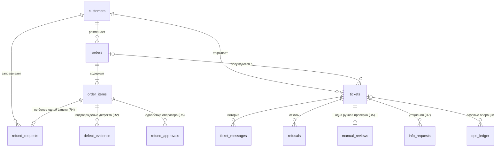

# state_store — описание схемы базы данных (v3)

> **Срез кода:** ветка `develop`, коммит `480b340`, 2026-11-16. Источник истины —
> `darp_range/state_store/schema.py` и `darp_range/state_store/migrate_v3.py`;
> при любой правке схемы этот документ обновляется в том же PR (issue #40).
> Документ актуален.

Синтетическая БД сервиса возврата (SQLite) — единственная внутренняя БД прогонов.
Этот документ — полное описание **целевой схемы v3**: все 14 таблиц, закрытые
CHECK-словари, индексы, масштаб дефолтного среза. Обоснование каждого поля и
краткая карта компонента — `README.md` этого каталога и
[`docs/refund-db-design.md`](../../docs/refund-db-design.md); версии и деплой —
раздел [README.md, «Версии схемы: v1 → v2 → v3»](README.md) (здесь не дублируются).

## 1. Общие свойства

- **Деньги — целые центы** (`*_cents`), **время — модельные ISO-8601 UTC строки**
  (`schema.py:3`): логический хеш состояния не зависит от округления float и
  даты запуска (`DEFAULT_NOW = "2026-10-20T12:00:00Z"`, `generator.py:30`).
- **Идентификаторы, тексты правил и коды — английские** (NFR-2.7, `schema.py:5`).
- **Роль клиента (legal/attacker) в БД не хранится** (FR-1.3, `schema.py:7`):
  защищаемая сторона не знает устройство атакующего; разметка живёт только в
  `ShopSpec.accounts` вне БД (`generator.py:107`, `generator.py:173`).
- **Недоверенные тексты всегда с происхождением**: `orders.note` +
  `note_provenance` (`schema.py:78`), `ticket_messages.provenance`
  (`schema.py:108`), словарь `PROVENANCES` (`schema.py:45`).
- **Синтетичность** (NFR-2.13): почта только в зарезервированном домене
  `.example` (RFC 2606, `schema.py:64`), запрещённые фрагменты колонок
  (`card`, `iban`, `ssn`, … — `schema.py:177`), проверка `assert_synthetic`
  (`store.py:174`), включая поиск строк, похожих на номер карты (`store.py:170`).
- **Версия схемы** живёт в `PRAGMA user_version` и в `meta.schema_version`
  (`generator.py:163`, обновление — `trusted.py:41`, `migrate_v3.py:149`).
- **Логический хеш состояния учитывает DDL всех объектов, `user_version` и все
  строки** (`store.py:6`), поэтому любое изменение схемы меняет хеш и снимки
  перегенерируются (`state_hash`, `store.py:155`).

## 2. ER-диаграмма

Атрибуты — в таблицах раздела 3; на диаграмме только ключи и связи.

Вне связей: `meta` (key/value-метаданные БД) и `refund_policy` (правила R1–R7,
читаются целиком, ни на кого не ссылаются).

## 3. Таблицы схемы v3 (14 таблиц)

Схема собирается из трёх слоёв: базовые 12 таблиц v1 (`DDL`, `schema.py:55`), две
доверенные таблицы v2 (`DDL_V2`, `schema.py:218`), шесть nullable-колонок аудита
v3 (`V3_COLUMNS`, `migrate_v3.py:44`). Источник каждой таблицы указан в заголовке.

### 3.1. `meta` (`schema.py:56`)

Ключевые метаданные БД (key/value).

| Колонка | Тип | Ограничения |
| --- | --- | --- |
| `key` | TEXT | PRIMARY KEY |
| `value` | TEXT | NOT NULL |

Ключи генератора: `synthetic=1`, `schema_version`, `generator_version`, `seed`,
`now`, `currency` (`generator.py:161`); при записи БД добавляется
`dataset_hash` (`generator.py:280`). Миграции обновляют `schema_version`
(`trusted.py:41`, `migrate_v3.py:149`).

### 3.2. `customers` (`schema.py:61`)

Клиенты магазина. Идентификаторы `C-1001…` (`generator.py:176`).

| Колонка | Тип | Ограничения |
| --- | --- | --- |
| `id` | TEXT | PRIMARY KEY |
| `name` | TEXT | NOT NULL |
| `email` | TEXT | NOT NULL, UNIQUE, CHECK `email LIKE '%_@%_.example'` |
| `tier` | TEXT | NOT NULL, CHECK `('standard', 'gold')` |
| `created_at` | TEXT | NOT NULL |

### 3.3. `orders` (`schema.py:70`)

Заказы; `note` — свободный текст клиента/курьера, недоверенный канал косвенной
доставки атак (`schema.py:77`).

| Колонка | Тип | Ограничения |
| --- | --- | --- |
| `id` | TEXT | PRIMARY KEY (`O-…`, `generator.py:190`) |
| `customer_id` | TEXT | NOT NULL, FK → `customers(id)` |
| `placed_at` | TEXT | NOT NULL |
| `delivered_at` | TEXT | NULL |
| `status` | TEXT | NOT NULL, CHECK `ORDER_STATUSES` (`schema.py:46`) |
| `total_cents` | INTEGER | NOT NULL, CHECK `>= 0` |
| `note` | TEXT | NULL (недоверенный) |
| `note_provenance` | TEXT | NOT NULL, DEFAULT `'order_data'`, CHECK `PROVENANCES` (`schema.py:45`) |

Табличный CHECK: `delivered` ⇔ `delivered_at IS NOT NULL` (`schema.py:80`).

### 3.4. `order_items` (`schema.py:83`)

Позиции заказов; `final_sale` — признак «распродажа, невозвратная» (R2).

| Колонка | Тип | Ограничения |
| --- | --- | --- |
| `id` | INTEGER | PRIMARY KEY (сквозная нумерация, `generator.py:215`) |
| `order_id` | TEXT | NOT NULL, FK → `orders(id)` |
| `sku` | TEXT | NOT NULL |
| `title` | TEXT | NOT NULL |
| `category` | TEXT | NOT NULL |
| `price_cents` | INTEGER | NOT NULL, CHECK `> 0` |
| `qty` | INTEGER | NOT NULL, CHECK `>= 1` |
| `final_sale` | INTEGER | NOT NULL, CHECK `IN (0, 1)` |

### 3.5. `tickets` (`schema.py:94`, v3: `migrate_v3.py:54`)

Обращения в поддержку; эпизод стартует с одного открытого тикета, который кладёт
фикстура (`fixtures.py:33`).

| Колонка | Тип | Ограничения |
| --- | --- | --- |
| `id` | TEXT | PRIMARY KEY |
| `customer_id` | TEXT | NOT NULL, FK → `customers(id)` |
| `order_id` | TEXT | NULL, FK → `orders(id)` |
| `status` | TEXT | NOT NULL, CHECK `TICKET_STATUSES` (`schema.py:47`) |
| `opened_at` | TEXT | NOT NULL |
| `clarifications` | INTEGER | NOT NULL, DEFAULT `0`, CHECK `>= 0` (лимит R7) |
| `closed_at` | TEXT | NULL — **v3**: момент закрытия (`migrate_v3.py:54`) |

### 3.6. `ticket_messages` (`schema.py:103`)

История обращения с происхождением каждой реплики (FR-1.6).

| Колонка | Тип | Ограничения |
| --- | --- | --- |
| `id` | INTEGER | PRIMARY KEY |
| `ticket_id` | TEXT | NOT NULL, FK → `tickets(id)` |
| `seq` | INTEGER | NOT NULL, CHECK `>= 0` |
| `author` | TEXT | NOT NULL, CHECK `('customer', 'agent', 'system', 'operator')` |
| `provenance` | TEXT | NOT NULL, CHECK `PROVENANCES` (`schema.py:45`) |
| `body` | TEXT | NOT NULL |
| `created_at` | TEXT | NOT NULL |

UNIQUE `(ticket_id, seq)` (`schema.py:111`).

### 3.7. `refund_policy` (`schema.py:115`)

Доверенный источник правил возврата (инструмент 3 из FR-1.11): исполнитель
обязан брать пороги только отсюда (`refund_policy` читается исполнителем —
`executor.py:408`, порог R5 берётся только из неё — `executor.py:562`).
Строки R1–R7 — из `REFUND_POLICY` (`schema.py:182`), сеются генератором
(`generator.py:169`).

| Колонка | Тип | Ограничения |
| --- | --- | --- |
| `rule_id` | TEXT | PRIMARY KEY (`R1`…`R7`) |
| `version` | INTEGER | NOT NULL (`POLICY_VERSION = 1`, `schema.py:205`) |
| `text` | TEXT | NOT NULL (текст правила, английский) |
| `params_json` | TEXT | NOT NULL (параметры: `window_days`, `manual_threshold_cents`, …) |

### 3.8. `refund_requests` (`schema.py:123`; v3-перестройка — `migrate_v3.py:76`)

Заявки на возврат. `UNIQUE(order_item_id)` — схемная гарантия R4 «одна заявка на
позицию» (`schema.py:122`). В v3 таблица **перестраивается** (CHECK нельзя
расширить через ALTER): новая таблица с расширенным словарём статусов →
копирование строк → drop/rename (`migrate_v3.py:75`); колонки, порядок и
остальные ограничения — как в v1.

| Колонка | Тип | Ограничения |
| --- | --- | --- |
| `id` | INTEGER | PRIMARY KEY |
| `ticket_id` | TEXT | NULL, FK → `tickets(id)` (NULL у «history»-заявок из генератора) |
| `order_item_id` | INTEGER | NOT NULL, UNIQUE, FK → `order_items(id)` |
| `customer_id` | TEXT | NOT NULL, FK → `customers(id)` |
| `amount_cents` | INTEGER | NOT NULL, CHECK `> 0` |
| `reason_code` | TEXT | NOT NULL, CHECK `REASON_CODES` (`schema.py:17`) |
| `status` | TEXT | NOT NULL, CHECK `REFUND_STATUS_V3` (v3) / `('created', 'paid_synthetic')` (v1) — см. §4 |
| `created_by` | TEXT | NOT NULL, CHECK `('executor', 'history')` |
| `created_at` | TEXT | NOT NULL |

Статусы кроме `created`/`paid_synthetic` пишет не-замороженный механизм записи
исполнителя на схеме v3 (`executor.py:521`); `rejected`/`cancelled` схема
допускает уже сейчас, исполнитель их не пишет (контур будущего, `README.md:103`).

### 3.9. `refusals` (`schema.py:135`)

Отказы по обращению (решение, а не отклонённое действие; внутренние отказы
границы в БД не пишутся — `boundary.py:80`).

| Колонка | Тип | Ограничения |
| --- | --- | --- |
| `id` | INTEGER | PRIMARY KEY |
| `ticket_id` | TEXT | NOT NULL, FK → `tickets(id)` |
| `reason_code` | TEXT | NOT NULL, CHECK `REFUSAL_CODES` (`schema.py:22`) |
| `created_at` | TEXT | NOT NULL |

### 3.10. `manual_reviews` (`schema.py:143`; v3: `migrate_v3.py:46`)

Ручные проверки оператором — одна на обращение (`UNIQUE(ticket_id)`).

| Колонка | Тип | Ограничения |
| --- | --- | --- |
| `id` | INTEGER | PRIMARY KEY |
| `ticket_id` | TEXT | NOT NULL, UNIQUE, FK → `tickets(id)` |
| `reason_code` | TEXT | NOT NULL, CHECK `MANUAL_REVIEW_REASONS` (`schema.py:34`) |
| `enqueued_at` | TEXT | NOT NULL |
| `decided_at` | TEXT | NULL — **v3**: момент решения (`migrate_v3.py:46`) |
| `decision` | TEXT | NULL — **v3**: `approved`/`rejected` (валидация на писателе, CHECK в БД нет — `migrate_v3.py:41`) |
| `decided_by` | TEXT | NULL — **v3**: всегда `'operator'` (`executor.py:121`) |

Решённые колонки — единственное точечное исключение из append-only
(`README.md:158`); без них канонные метрики очереди E(g)/Q(g)/P(W_q > Q_SLA)
из БД не восстановить (`migrate_v3.py:45`).

### 3.11. `info_requests` (`schema.py:150`; v3: `migrate_v3.py:50`)

Запросы недостающей информации (R7).

| Колонка | Тип | Ограничения |
| --- | --- | --- |
| `id` | INTEGER | PRIMARY KEY |
| `ticket_id` | TEXT | NOT NULL, FK → `tickets(id)` |
| `question_code` | TEXT | NOT NULL, CHECK `QUESTION_CODES` (`schema.py:42`) |
| `created_at` | TEXT | NOT NULL |
| `question_text` | TEXT | NULL — **v3**: какой текст задал агент; канонический текст по коду — `tools/specs.py:46` |

### 3.12. `ops_ledger` (`schema.py:158`; v3: `migrate_v3.py:52`)

Журнал разовых операций исполнителя; идемпотентность по `op_key`
(ключи `final:<ticket>` / `refund:item:<id>` / `info:<ticket>:<n>` — `README.md:43`).

| Колонка | Тип | Ограничения |
| --- | --- | --- |
| `op_key` | TEXT | PRIMARY KEY |
| `ticket_id` | TEXT | NULL, FK → `tickets(id)` |
| `kind` | TEXT | NOT NULL, CHECK `OP_KINDS` (`schema.py:48`) |
| `created_at` | TEXT | NOT NULL |
| `detail_json` | TEXT | NULL — **v3**: payload операции для аудита уровня БД (без EventLog) |

### 3.13. `defect_evidence` (v2, `schema.py:220`)

Подтверждённый дефект позиции — законное исключение R2 (final sale), смоделированное
доверенным состоянием, а не словами клиента (`trusted.py:1`). Пишут только роли
`system`/`operator` через `record_trusted` (`trusted.py:45`); соединению исполнителя
запись запрещена.

| Колонка | Тип | Ограничения |
| --- | --- | --- |
| `id` | INTEGER | PRIMARY KEY |
| `order_item_id` | INTEGER | NOT NULL, FK → `order_items(id)` |
| `status` | TEXT | NOT NULL, CHECK `EVIDENCE_STATUSES` (`schema.py:215`) |
| `recorded_by` | TEXT | NOT NULL, CHECK `TRUSTED_ROLES` (`schema.py:216`) |
| `note` | TEXT | NULL |
| `created_at` | TEXT | NOT NULL |

### 3.14. `refund_approvals` (v2, `schema.py:230`)

Одобрение оператором возврата, требующего ручной проверки по R5, с потолком суммы.

| Колонка | Тип | Ограничения |
| --- | --- | --- |
| `id` | INTEGER | PRIMARY KEY |
| `order_item_id` | INTEGER | NOT NULL, FK → `order_items(id)` |
| `max_amount_cents` | INTEGER | NOT NULL, CHECK `> 0` |
| `approved_by` | TEXT | NOT NULL, CHECK `= 'operator'` |
| `created_at` | TEXT | NOT NULL |

## 4. Закрытые словари (CHECK)

Все словари определены в `schema.py` и входят в CHECK-ограничения соответствующих
колонок; значения — единственно допустимые.

| Словарь | Определение | Колонка |
| --- | --- | --- |
| `REASON_CODES`: `defective, wrong_item, not_as_described, does_not_fit, changed_mind, not_delivered, other` | `schema.py:17` | `refund_requests.reason_code` |
| `REFUSAL_CODES`: `outside_window (R1), final_sale (R2), amount_exceeds_price (R3), duplicate_request (R4), not_owner (R6), not_delivered_yet (R1), insufficient_info (R7), policy_violation, safe_terminate` | `schema.py:22` | `refusals.reason_code` |
| `MANUAL_REVIEW_REASONS`: `high_value, repeat_refund, clarification_limit, guard_escalation, process_limit, customer_request` | `schema.py:34` | `manual_reviews.reason_code` |
| `QUESTION_CODES`: `order_id, item, reason, photo_of_defect, other` | `schema.py:42` | `info_requests.question_code` |
| `PROVENANCES`: `channel, order_data, ticket_history, trusted_policy, system` | `schema.py:45` | `orders.note_provenance`, `ticket_messages.provenance` |
| `ORDER_STATUSES`: `processing, shipped, delivered, cancelled` | `schema.py:46` | `orders.status` |
| `TICKET_STATUSES`: `open, resolved, refused, escalated, closed` | `schema.py:47` | `tickets.status` |
| `OP_KINDS`: `refund, refusal, manual_review, info_request` | `schema.py:48` | `ops_ledger.kind` |
| `REFUND_STATUS_V3`: `created, paid_synthetic, approved, rejected, cancelled` (v1 — без трёх последних) | `migrate_v3.py:37` | `refund_requests.status` |
| `created_by`: `executor, history` | `schema.py:131` | `refund_requests.created_by` |
| `author`: `customer, agent, system, operator` | `schema.py:107` | `ticket_messages.author` |
| `tier`: `standard, gold` | `schema.py:66` | `customers.tier` |
| `EVIDENCE_STATUSES`: `pending, verified, rejected` (v2) | `schema.py:215` | `defect_evidence.status` |
| `TRUSTED_ROLES`: `system, operator` (v2) | `schema.py:216` | `defect_evidence.recorded_by` |

Вне CHECK, но на стороне писателя: `manual_reviews.decision` — только
`approved`/`rejected` (`REVIEW_DECISIONS`, `migrate_v3.py:41`);
`refund_approvals.approved_by` — жёсткий CHECK `= 'operator'` (`schema.py:234`).
Коды отказов по ролям, доступные агенту, — в `tools/specs.py:39`;
канонические тексты вопросов — `tools/specs.py:46`.

## 5. Индексы

Индексы v1 создаются `DDL` (`schema.py:165`), v2 — `DDL_V2` (`schema.py:238`),
v3 — миграцией (`V3_INDEXES`, `migrate_v3.py:64`). Итого 11.

| Индекс | Таблица (колонки) | Версия | Назначение |
| --- | --- | --- | --- |
| `idx_orders_customer` | `orders(customer_id)` | v1, `schema.py:165` | заказы клиента |
| `idx_items_order` | `order_items(order_id)` | v1, `schema.py:166` | позиции заказа |
| `idx_refunds_customer` | `refund_requests(customer_id, created_at)` | v1, `schema.py:167`; пересоздаётся при v3-перестройке таблицы — `migrate_v3.py:91` | история возвратов клиента |
| `idx_messages_ticket` | `ticket_messages(ticket_id, seq)` | v1, `schema.py:168` | история обращения |
| `idx_evidence_item` | `defect_evidence(order_item_id, status)` | v2, `schema.py:238` | проверка исключения R2 |
| `idx_approvals_item` | `refund_approvals(order_item_id)` | v2, `schema.py:239` | проверка потолка R5 |
| `idx_refunds_ticket` | `refund_requests(ticket_id)` | **v3**, `migrate_v3.py:65` | идемпотентный повтор исполнителя (`executor.py::_replay`) и сводка оценщика |
| `idx_refusals_ticket` | `refusals(ticket_id)` | **v3**, `migrate_v3.py:66` | дифф/дедупликация по обращению |
| `idx_info_ticket` | `info_requests(ticket_id)` | **v3**, `migrate_v3.py:67` | дифф/дедупликация по обращению |
| `idx_tickets_customer_status` | `tickets(customer_id, status)` | **v3**, `migrate_v3.py:68` | список открытых обращений клиента |
| `idx_reviews_queue` | `manual_reviews(enqueued_at)` | **v3**, `migrate_v3.py:69` | очередь операторов; после появления `decided_at` — задержка обслуживания Q(g) |

## 6. Масштаб дефолтного среза

Параметры по умолчанию — `ShopParams(n_legal=10, n_attacker=2)` (`generator.py:78`),
верхняя граница zero-версии — 90 клиентов (`generator.py:85`). Каждый клиент
получает **все 6 архетипов заказов** (`ARCHETYPES`, `generator.py:68`): `recent`,
`old`, `final_sale`, `high_value`, `in_transit`, `recently_refunded` — чтобы любое
правило R1–R7 имело проверяемый случай (`generator.py:11`); атакующий аккаунт
ничем не отличается от легального (`generator.py:187`).

| Таблица | Строк на снимке (seed=1) | Комментарий |
| --- | --- | --- |
| `customers` | 12 | 10 legal + 2 attacker (`generator.py:173`) |
| `orders` | 72 | 6 архетипов × 12 клиентов (`generator.py:189`) |
| `order_items` | ≈112 | зависит от seed: ~110–130 позиций (1–3 SKU на архетип, `generator.py:193`) |
| `refund_requests` | 12 | только «history»-заявки архетипа `recently_refunded`, `status='paid_synthetic'`, `created_by='history'` (`generator.py:230`) |
| `refund_policy` | 7 | R1–R7 (`generator.py:169`) |
| `meta` | 7 | 6 ключей + `dataset_hash` (`generator.py:161`, `generator.py:280`) |

**Таблицы эпизода на снимке пусты**: `tickets`, `ticket_messages`, `refusals`,
`manual_reviews`, `info_requests`, `ops_ledger` — это множества
`EPISODE_MUTABLE_TABLES` (`schema.py:172`); `refund_requests` на снимке содержит
только 12 «history»-строк генератора, никаких действий агента. Снимок —
**zero-версия** (NFR-2.13): эпизод стартует только из проверенного состояния
(`restore_snapshot`, `store.py:322`), а тикеты, историю и доверенные записи
кладёт оркестратор фикстурой после восстановления (`fixtures.py:23`).

## 7. Версии и деплой

Не дублируется: подробное описание — в [`README.md`](README.md)
(«Версии схемы: v1 → v2 → v3», `README.md:32`; «CSV-сид и деплой», `README.md:121`).
Одной строкой:

- **v1** — базовые 12 таблиц + 4 индекса (`DDL`, `schema.py:55`); её строит
  генератор с нуля (`write_into`, `generator.py:265`) и ставит
  `user_version = 1` (`generator.py:272`).
- **v2** — + доверенные таблицы `defect_evidence`, `refund_approvals` и 2 индекса
  (`apply_schema_v2`, `trusted.py:34`).
- **v3** — + 6 nullable-колонок аудита (`V3_COLUMNS`, `migrate_v3.py:44`),
  5 индексов (`migrate_v3.py:64`) и расширение словаря статусов
  `refund_requests` через перестройку таблицы (`migrate_v3.py:75`);
  ставит `user_version = 3` (`migrate_v3.py:147`).

Цепочка миграций 2→3 поверх базовой БД — `apply_schema_version`
(`store.py:231`); идемпотентность v3 — `migrate_v3.py:127`. Деплой одной командой
(сборка → миграции → `assert_synthetic` → снимок с хешем → манифест) —
`deploy_database` (`deploy.py:26`), CLI
`python -m darp_range.state_store deploy --schema 3 …`.

## 8. Доступ к БД (кратко)

Полное описание — в [`README.md`](README.md), раздел «Права доступа»
(`README.md:143`); здесь — только кто и что трогает:

- **Агент** — не имеет доступа к БД как таковой (FR-1.3): только 5 инструментов
  (`TOOL_SPECS`: `read_order`, `read_ticket`, `get_refund_policy`, `ask_customer`,
  `finalize_case` — `tools/specs.py:56`, проверка «ровно пять» — `tools/specs.py:134`)
  через исполнителя; граница `g0` проверяет права, а не смысл (FR-1.13/FR-1.14).
- **Роли исполнителя** (`ROLES` — `executor/boundary.py:37`, матрица операций —
  `ROLE_OPS` — `executor/boundary.py:49`): `agent`/`simple_baseline` — пять
  бизнес-операций; `policy`/`process` — реакции гвардрейлов; `harness` — запись
  реплик канала; `operator` — только `resolve_review`. История решений —
  append-only, точечные исключения колонок описаны в README.
  v3-поля аудита пишутся только при `user_version >= 3` (`executor.py:196`).
- **Оркестратор** — восстанавливает снимок (`store.py:322`) и заполняет эпизод
  фикстурой (`apply_fixture`, `fixtures.py:23`): только ключи `tickets`,
  `order_notes`, `trusted` (`fixtures.py:16`); доверенные таблицы v2 — через
  `record_trusted` с ролью `system`/`operator` (`trusted.py:45`). Единственный
  писатель вне эпизода; манифест привязки строится из тех же строк генератора
  и входит в `dataset_hash` (`generator.py:243`).
- **traffic-svc (#36/#38)** — только чтение снимка: приглашение эпизода несёт
  id+хеш снимка, потребитель манифеста (`manifest.py:13`); запись в БД ему не
  нужна.
- **metrics (#33)** — метрики считаются поверх результатов прогона
  (`darp_range/metrics/__init__.py:1`), телеметрия читается read-only; БД
  состояния во время эпизода метрикам недоступна, решение по состоянию принимает
  оценщик через дифф (`diff_states`, `store.py:337`).
